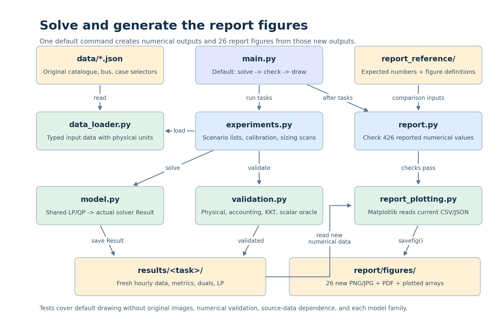
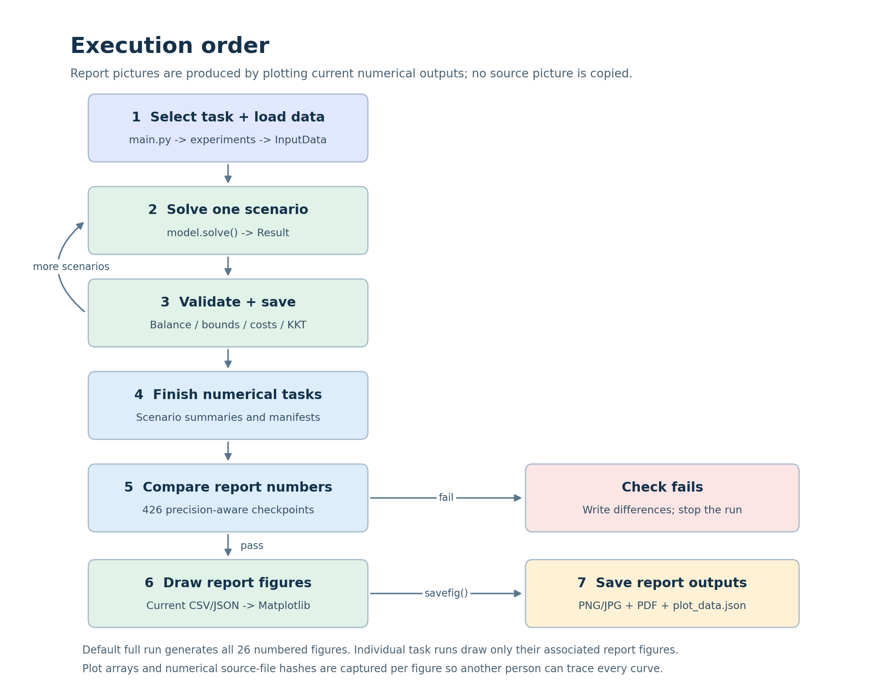

# DTU 46750 — Group 15: solve and generate all report figures



**This Python package integrates the contents of all branches and modularizes them, enabling the reader to better understand the code and its relationship to the results presented in the report.** The original JSON inputs, shared optimization model, code comments, single root `main.py`, and validation/test coverage are retained.


## 1. Run the complete report package

Run from the directory containing `main.py`:

```bash
python -m pip install -r requirements.txt
python -m pytest -q
python main.py --task all
```

The default full run executes all numerical experiments, checks physical and KKT
conditions for every scenario, compares 426 report checkpoints, and then freshly
renders all 26 numbered report figures. Numerical failures stop before plotting.

**The newly generated report pictures are in `results/report/figures/`.**
The Q1/Q2/Q3 folders and filenames match the paths used in the uploaded LaTeX.
`results/report/figure_index.csv` maps Figures 1–26 to those files.

`results/report/numerical_match.csv` contains, for every checkpoint, its source
LaTeX file, computed output file, report value, computed value, difference,
tolerance, and pass/fail status. `results/report/manifest.json` records the
comparison scope, generated-image hashes, source numerical files, and drawing
provenance. The report's own text is not rewritten.

## 2. Python environment

Recommended: **Python 3.12, 64-bit**, with Gurobi 13.0.1. Use `requirements.txt`
for bounded compatible dependencies, or `requirements-lock.txt` for the exact
top-level versions used in verification. An environment is needed only for
computing: after running, the generated PNG/JPG files can be opened without Python.

### Windows PowerShell

```powershell
python --version
python -m venv .venv
.\.venv\Scripts\Activate.ps1
python -m pip install --upgrade pip
python -m pip install -r requirements-lock.txt
python -m pytest -q
python main.py --task all
```

If activation is blocked, call the interpreter directly:

```powershell
.\.venv\Scripts\python.exe -m pip install -r requirements-lock.txt
.\.venv\Scripts\python.exe -m pytest -q
.\.venv\Scripts\python.exe main.py --task all
```

### Windows CMD

```bat
python -m venv .venv
.venv\Scripts\activate.bat
python -m pip install -r requirements-lock.txt
python -m pytest -q
python main.py --task all
```

### macOS / Linux

```bash
python3.12 -m venv .venv
source .venv/bin/activate
python -m pip install -r requirements-lock.txt
python -m pytest -q
python main.py --task all
```

### Conda

```bash
conda env create -f environment.yaml
conda activate dtu46750-group15
python -m pytest -q
python main.py --task all
```

The optimization models are continuous LP/QPs; the battery model has 168
variables. Verification used the bundled restricted Gurobi license. Keep private license files and keys out of Git.

## 3. Commands and experiment locations

| Report item | Command | Numerical experiment function |
|---|---|---|
| Q1(e–f), Cases A/B | `python main.py --task 1f` | `q1()` |
| Q1(e) alias, also both cases | `python main.py --task 1e` | `q1()` |
| Q2(b), linear comfort | `python main.py --task 2b` | `q2b()` |
| Q2(c), quadratic comfort | `python main.py --task 2c` | `q2c()` |
| Q2(d), model comparison | `python main.py --task 2d` | `q2d()` |
| Q2(e), non-separable extension | `python main.py --task 2e` | `q2e()` |
| Q3(d), model/validation alias | `python main.py --task 3d` | `q3base()` |
| Q3(e), daily requirement | `python main.py --task 3e` | `q3base()` |
| Q3(f), two sensitivity experiments | `python main.py --task 3f` | `q3f()` |
| Q3(g), battery and terminal alternatives | `python main.py --task 3g` | `q3g()` |
| Next-day pi calibration alone | `python main.py --task 3g-pi` | `calibrate_pi()` |
| Q3(g)(v), sizing/volatility/plateaus | `python main.py --task 3g-sensitivity` | `q3g_sensitivity()` |
| List tasks | `python main.py --list-tasks` | CLI help |
| Full numerical reproduction + freshly drawn report figures | `python main.py --task all` | all report tasks |
| Tests | `python -m pytest -q` or `python main.py --task test` | `tests/` |

The functions above are in `src/experiments.py`. All reuse `src/model.py` rather
than separate per-question solvers. Theory items remain in the report and are
checked where appropriate through the scalar oracle, KKT, and edge-case tests.

A single-task run checks its own numerical checkpoints and exports the associated
newly rendered report images. Its manifest says **partial scope**; it is not a full
report reproduction. Standalone pi calibration has no numbered figure export.

Additional controls:

```bash
python main.py --help
python main.py --task all --output-dir results_review
python main.py --task all --no-plots
python main.py --task all --quick --output-dir smoke_results
```

`--output-dir` is a parent: task folders and `report/` are placed below it.
`--no-plots` keeps numerical checks but skips figure generation. No extra plotting
flag is needed: drawing is already enabled by default.
`--quick` skips dense sizing and plateau searches; its report scope is explicitly
incomplete and four sizing figures are omitted, so do not use it for the final report. A rerun overwrites
same-named files; use a separate output parent to retain independent executions.

## 4. Module relationships and execution order



| Module/folder | Responsibility |
|---|---|
| `main.py` | Sole entry point: solve, check, and render report figures by default |
| `src/data_loader.py` | JSON catalogue/bus/case joining and physical unit conversions |
| `src/model.py` | Shared LP/QP construction, solving, `Result`, cost and dual extraction |
| `src/validation.py` | Physical/accounting/KKT checks and independent scalar optimization |
| `src/experiments.py` | Report parameter lists, comparisons, pi calibration, plateau search |
| `src/report.py` | Compare solver outputs with report numerical expectations; no picture reads |
| `src/report_plotting.py` | Generate all numbered report figures from numerical CSV/JSON and capture plotted arrays |
| `src/plotting.py` | Retained general diagnostic plotting helpers used by the experiment API |
| `tests/` | Input, mathematical model, experiment, and report integrity tests |
| `report_reference/source/` | Report LaTeX text for traceability; original pictures are deliberately absent |
| `report_reference/contract.json` | Report image names/dimensions, numeric expectations, rounding tolerances, known conflicts |
| `results/<task>/runs/<scenario>/` | Newly executed numerical run files |
| `results/report/figures/` | Newly generated PNG/JPG, vector PDF, and `.plot_data.json` files |
| `results/report/numerical_match.csv` | Report-versus-computed numerical comparisons |

Normal execution is:

1. Load input and define a scenario copy.
2. Solve the shared LP/QP.
3. Validate its physical equations, accounting, and optimality.
4. Save its hourly schedule, metrics, input snapshot, dual rows, and model LP.
5. Repeat and create the task's numerical summary/manifest.
6. Compare selected results with the report's checkpoint list.
7. If comparisons pass, render the associated PNG/JPG/PDF figures with Matplotlib,
   capture their plotted arrays, and record numerical source-file checksums.

For battery tasks, next-day solves calibrate pi first. Current-day scenarios use
that same pi. Tests are run explicitly; `--task all` does not implicitly run pytest.

## 5. All 26 report figures

See `docs/FIGURE_MAP.md` for the exact paths. The following groups are included:

- Figures 1–2: Q1 four-panel A/B overviews.
- Figures 3–4: linear base and response at hours 7, 9, 11, 18.
- Figures 5–6: quadratic base and four-panel sensitivity, hours 5, 8, 12, 18.
- Figures 7–8: two-panel model comparison and coefficient responses.
- Figures 9–11: separate non-separable base, comparison, and timing profiles.
- Figures 12–13: daily requirement, including signed deviations and two-model flows.
- Figures 14–17: daily-minimum/cQ summaries and six-panel load comparisons.
- Figures 18–20: storage dispatch, 2x2 flow/price comparison, signed/absolute deviations.
- Figures 21–25: capacity, common power, price volatility and conditional scans,
  including the report's base/saturation marks and line-style explanations.
- Figure 26: appendix linear/quadratic benchmark.

The 26 images are created by `Figure.savefig()` from current solved data. The
original report images are not bundled, opened, or copied. Generated-file hashes
identify the new run; reference hashes are retained only as review metadata, not
as an output-copy mechanism or a requirement to fabricate historical pixels.

## 6. Mathematical conventions and experiments

Each interval is 1 hour, t=0,...,23. `load`, `pv`, `import`, `export` are interval
energy in kWh. Battery `charge`/`discharge` are kW, numerically kWh over 1 hour.
`soc[t]` is end-of-hour internal energy at boundary t+1; initial SOC is boundary 0.

Effective prices are `a=p+import_tariff`, `b=p-export_tariff`.
Procurement is `C=sum(cPV*PV+a*import-b*export)`.

| Model | Maximized objective |
|---|---|
| Q1 | `sum(u*L)-C` |
| Q2 linear | `-C-cL*sum(abs(L-reference))` |
| Q2 quadratic / Q3 | `-C-cQ*sum((L-reference)^2)` |
| Non-separable | quadratic minus `cS*sum((delta[t]+delta[t-1])^2)` |
| Value battery | selected objective plus `pi*soc[23]` once |
| Cyclic battery | no terminal credit; impose `soc[23]=initial_SOC` |

The non-separable penalty is the **sum** of adjacent deviations, as stated in
the report formula. Complete disutility includes local and coupling terms.
`total_cost=C+D` excludes the terminal credit. Raw battery operating value is an
objective difference; inventory-adjusted value subtracts `pi*initial_SOC` and
does not subtract equipment investment or degradation cost.

All variable bounds are explicit rows. Exported `dual_*` columns contain raw
Gurobi RHS sensitivities Pi. In report notation:

- `lambda=-dual_balance`;
- lower-bound multiplier = `-Pi`, upper-bound multiplier = `+Pi`;
- `mu=-Pi(minimum_energy)`;
- initial inventory sensitivity = `+Pi(storage_balance[0])`;
- capacity marginal = sum of SOC-upper Pi;
- common-power marginal = sum of charging-upper plus discharging-upper Pi.

Ties can produce nonunique decisions/duals. Different allocations in equally
priced battery charging hours do not justify changing model coefficients to
force an old solver trajectory. Both generated figures and CSVs show the actual newly solved choices. Raw Q1
duals use the same explicit-row RHS convention as the original code.

Original JSON bytes are checked against `docs/data_hashes.json`. Scenario changes
use `dataclasses.replace`; the source data files are not rewritten.

- Q2(b): 34 distinct weights, including threshold ±0.001 and exact ties.
- Q2(c): cQ=0.05,0.1,0.2,0.5,1,2,5,10.
- Q2(d): low/base/high comparison plus the report's 34 linear and eight quadratic
  response samples (49 total solves including the Q1 comparison).
- Q2(e): cS=1; alternating [1,2] repeated 12 times and six-hour low/high blocks.
- Q3(f): Emin=20,22.765,25,32.34,40,48 at cQ=1; cQ=0.1,0.5,1,2,5,10 at Emin=30.
- Pi calibration: next-day forecasts, initial 2 kWh, central steps .001/.01/.1;
  select .01 estimate; free day-2 terminal SOC with zero day-3 reward.
- Q3 battery: Emin=40, cQ=1, E=4 kWh, Pch=Pdis=1.5 kW, efficiencies .95,
  initial inventory 2 kWh. Compare value/cyclic/no-daily alternatives.
- Variability: mean(p)+alpha*(p-mean(p)); alpha=0,.5,1,1.5; calibrated pi fixed.
- Capacity/power scans retain initial 2 kWh, use right perturbation 1e-4, and
  locate zero marginal within numerical tolerance. They are conditional scans.

## 7. Integration into your branch

Copy this package into the new code branch as a complete project, including
`report_reference/contract.json` and `docs/diagrams/`. The former supplies report
comparison expectations; the latter displays the README structure diagrams. Keep one root Python runner: `main.py`.

Run the full command, inspect `results/report/numerical_match.csv`, then commit
source, tests, README, and report numerical references. `results/` is ignored by Git by
default although execution results are included in this downloaded ZIP. If you
want results tracked in the branch, deliberately adjust `.gitignore` or force-add
selected outputs. Do not commit virtual environments, caches, or private licenses.

The original course data/starter source is
https://github.com/lemitri-DTU/template-assignment-1. 
